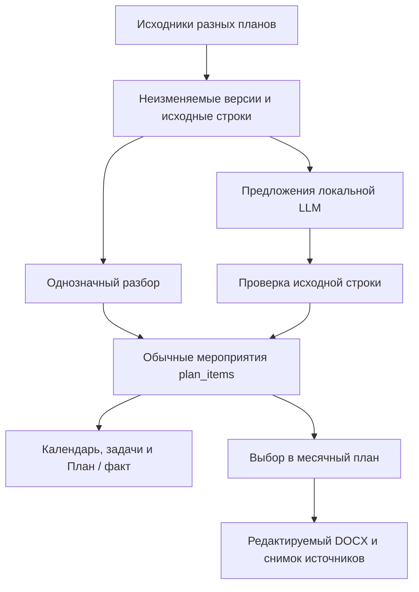

# Из нескольких планов в редактируемый план на месяц

Статус: реализация после рубежа `0.4.12`, SQLite schema **32**. Версия приложения и опубликованные release assets этим изменением не обновляются. Задача: [#371](https://github.com/f2re/kafedra-planner/issues/371). Исходный `main`: `8d6ec438563fefc52077bcc9058234c72a841bf3`.

## Задача и принятое решение

У кафедры есть несколько источников обязательств: годовой план института, план кафедры, научный план, личные планы сотрудников. Из них нужно получить мероприятия, увидеть их вместе, выбрать относящиеся к кафедре и подготовить документ на конкретный месяц. Повторная печать или смена оформления не должны создавать новые задачи и календарные записи.

Существующие `plan_items` остаются единственным рабочим реестром мероприятий. Общий список — проекция доступных пунктов разных планов. Месячный план хранит выбранные ссылки на эти пункты, порядок и формулировки для документа. Выгрузка фиксирует отдельный неизменяемый снимок выбранного состава и точной версии образца.

До изменения уже существовали импорт, исходные строки, ручные планы, календарь, выполнение и годовые DOCX-образцы. Новый контур использует эти механизмы. Старый годовой генератор создаёт новый рабочий план; для месячной подборки такое поведение неприемлемо, поэтому месячный экспорт имеет собственную регистрацию результата без повторного разбора документа.

## Пользовательский сценарий

1. В разделе **Планы** выбрать сразу несколько файлов. Каждый файл независимо проходит загрузку, сохранение исходника и обработку. Успешная строка открывает точный созданный план; ошибочная сохраняет ссылку на оригинал и действие повтора.
2. Однозначные мероприятия появляются в плане и календаре штатным способом. Неразобранные строки доступны в существующем редакторе исходных строк. При включённой локальной модели туда добавляются проверяемые предложения, в том числе несколько мероприятий из одной строки.
3. Открыть **Мероприятия и план на месяц**. Выбрать месяц, отфильтровать список по виду деятельности, исходному плану, названию или тексту кафедры/подразделения. При необходимости оставить включёнными мероприятия без точного срока.
4. Отметить нужные строки и нажать **Добавить выбранные**. Состав сохраняется на сервере и доступен после перезагрузки. Недоступный или отменённый пункт не мешает добавить остальные; результат сообщается по каждой строке.
5. Во вкладке **В плане** изменить порядок, формулировку, печатный срок, ответственного, результат и примечание. Эти значения относятся к документу. Реальный срок или выполнение меняются в исходном плане, который открывается из строки.
6. Выбрать **Стандартная таблица** либо загрузить собственный месячный DOCX-образец. При однозначном распознавании он сразу сохраняется; иначе пользователь уточняет соответствие колонок и периода.
7. Нажать **Скачать DOCX**. Полученный файл редактируется в Word/LibreOffice как обычный документ. В следующем месяце используется тот же сохранённый образец, а мероприятия выбираются для нового периода.

Смена месяца не переносит реальные сроки мероприятий и не клонирует прошлый состав автоматически. Отдельный месячный план можно сохранить пустым и заполнить позже. Удаление строки из состава не удаляет мероприятие, задачу или календарную запись.

## Разбор и роль LLM

### Базовый автономный путь

DOCX, ODT, XLSX, ODS, PDF и текст используют существующее извлечение текста, таблиц и OCR. Поддержка конкретного формата определяется установленными document capabilities. Оригинал, blob, SHA-256 и `document_version` сохраняются до разбора. Исходные строки, ячейки и локаторы остаются доступны даже при неудачной интерпретации.

Табличный и детерминированный разбор продолжают создавать однозначные пункты. Дополнительно сохраняются нераспознанные текстовые блоки без дат: ранее такой текст мог не попасть в редактор исходных строк. Отсутствие даты не превращается в сегодняшнюю дату. Невозможные даты, например `31 февраля`, остаются неразрешёнными и не расширяются до целого месяца. Общий парсер сохраняет границы диапазонов `10–12 ноября` и `28 ноября — 2 декабря`; список отдельных дат не превращает в непрерывный интервал.

### Необязательное обогащение

Задача [`plan-extract-v1`](../packages/ai/src/plan-task.mjs) использует существующие настройки локальной LLM. Доступен OpenAI-совместимый endpoint `llama.cpp`; обязательный облачный сервис не добавляется. Настройки читаются при выполнении задания, поэтому повтор использует актуальную конфигурацию.

LLM получает исходные строки и подтверждённый период плана. Извлечённый только по косвенным признакам год не передаётся как подтверждённый контекст. Ответ содержит `sourceRowKey`, заголовок, цитату, исходный текст даты/срока, ответственного, результат и вид деятельности. Текст документа считается данными, команды из него не исполняются; модель не получает инструменты записи в систему.

Перед сохранением проверяются:

- известный ключ исходной строки и строгая структура JSON без посторонних полей;
- непрерывная цитата в этой строке с нормализацией пробелов;
- заголовок внутри цитаты и каждое непустое извлечённое поле внутри той же исходной строки;
- допустимый вид деятельности и длины значений;
- даты штатным детерминированным парсером, без доверия к придуманным ISO-датам модели.

Ошибочная строка ответа отбрасывается отдельно. Принятая цитата подтверждает происхождение текста, но не заменяет проверку смысла и принадлежности мероприятия кафедре.

На запрос передаются до шести полных исходных строк; ответ ограничен 20 предложениями, 2048 токенами и 64 KiB. Размер входа учитывает настроенный контекст модели. Слишком длинная строка получает явную диагностику и остаётся для ручного разбора; молчаливого обрезания нет. При несовместимой поддержке JSON Schema допускается один запрос с обычным JSON-режимом, после которого действуют те же локальные проверки.

Worker ставит `enrich_plan` после сохранения плана. Один отдельный асинхронный слот позволяет обычным документам обрабатываться, пока модель отвечает. Lease продлевается под фактический timeout; владение заданием проверяется до запроса, перед сохранением и при завершении. Остановка worker ожидает текущую необязательную работу.

### Принятие предложения и история

LLM изменяет только предложения **ещё не материализованных** исходных строк. Уже созданные пункты и ручные исправления не заменяются новым машинным результатом. Проверка повторяется после ответа модели: запоздавший результат не перезаписывает работу пользователя.

Для строки сохраняются предыдущий детерминированный разбор, `suggestion.tasks[]`, модель, версия промпта, SHA-256 входа и идентификатор `llm_extraction_runs`. При принятии через существующее действие разбора создаются обычные пункты с `evidence.llmProposal`, цитатой и исходным locator. Последующие пользовательские правки идут штатным путём истории.

Эта версия не использует модель для массовой замены уже распознанных таблиц, автоматического подтверждения выполнения или скрытого отбора «только нашей кафедры». Рабочий сценарий доступен и с выключенной моделью.

## Общий перечень и виды деятельности

`GET /api/plan-events` объединяет доступные активные мероприятия. Фильтр месяца учитывает пересечение интервала и контрольный срок. Строки без даты можно включить явно; они отбираются с учётом года исходного плана. Пагинация применяется после проверки доступа и фильтров, поэтому скрытые строки не опустошают видимую страницу.

| Вид в интерфейсе | `activityKind` | Смысл |
| --- | --- | --- |
| Методическая работа | `methodological` | Материалы, программы, методические семинары |
| Занятия | `teaching` | Занятия и учебный процесс |
| Научная работа | `science` | Исследования, публикации, конференции |
| Организационная работа | `organizational` | Заседания и организационные мероприятия |
| Повседневная работа | `everyday` | Текущие хозяйственные мероприятия |

Старые четыре `direction` и их ограничения SQLite не меняются. `activityKind` — проекция: сначала явно принятая категория из evidence, затем детерминированная классификация текста и направления. Непринятое LLM-предложение не становится категорией рабочего мероприятия.

Поле **Кафедра / подразделение** выполняет прозрачный текстовый отбор по исходному плану, владельцу, ответственному и содержанию. Оно не является новой системой оргпринадлежности и не исключает строки по догадке. Пользователь может увидеть все доступные мероприятия и выбрать нужные самостоятельно.

## Месячный план, хранение и конкурентные правки

Добавочная [`032_monthly_plan_composition.sql`](../migrations/032_monthly_plan_composition.sql) создаёт три таблицы:

| Таблица | Что хранится |
| --- | --- |
| `monthly_plans` | Месяц, название, автор, образец, ревизия, ключ создания и хеш запроса |
| `monthly_plan_items` | Уникальная ссылка на `plan_item`, порядок, локальные формулировки и примечание |
| `monthly_plan_exports` | Ревизия состава, точная версия образца, неизменяемый JSON-снимок, хеш запроса, состояние и результат выгрузки |

Состав доступен создателю и администратору в рамках прежней модели доступа. Связи между рабочими пространствами запрещены. Повторное добавление возвращает существующую строку. При ошибке одного выбранного пункта успешные строки сохраняются. Связанный пункт нельзя физически удалить в обход ссылочной целостности.

Изменяющие запросы передают `expectedRevision`. Устаревший запрос получает конфликт; интерфейс сохраняет несохранённый ввод и позволяет обновить данные. Потеря ответа после успешного создания восстанавливает тот же состав по исходному ключу, включая случай последующего изменения названия формы.

Повтор загрузки использует ключ по содержимому, назначению и контексту пользователя. Сервер сверяет workspace и SHA-256, проверяет текущий read ACL уже существующего документа и не меняет его владельца при повторе. Другой файл под старым ключом получает конфликт. Для обычного локального HTTP предусмотрены автономные функции идентификаторов и SHA-256, без зависимости от доступности `SubtleCrypto`.

## Образец и DOCX-снимок

Без образца формируется редактируемая таблица: номер, вид деятельности, мероприятие, срок, ответственный, результат/примечание. Она сама пригодна как месячный образец.

Собственный образец хранится существующей сущностью `plan_document_templates`. Дополнен период `monthly`, например `2026-11`. Анализатор находит месяц в плановом заголовке, таблицу, колонки и строку для клонирования. Генератор сохраняет пакет OOXML, стили, колонтитулы и внешние части образца; заменяет только выбранный заголовок периода и строки таблицы. Месяц заменяется как целое слово с сохранением падежа и регистра. Неоднозначный месяц, таблица или объединённая строка требуют явного сопоставления.

При одной колонке срока выводятся интервал и контрольный срок. При двух колонках они разделяются. Явная пустая печатная правка не возвращает старую дату. Фактические даты исходного мероприятия при этом не меняются.

Перед генерацией фиксируются источники, effective-поля, локальные правки, порядок, ревизия, версия и SHA образца. После асинхронной записи файла в транзакции повторно проверяются доступ и хеш актуальных данных. Если источник успел измениться, публикация снимка останавливается с понятным конфликтом. Завершённый результат и его входной снимок защищены триггерами от изменения.

Повтор с тем же ключом и тем же содержимым возвращает прежний документ. Тот же ключ с изменёнными исходными данными получает конфликт. После исправления или обновления источника новая выгрузка создаёт новый снимок.

Результат регистрируется как обработанный `monthly_plan_export`: без `process_document`, новых `plan_items`, календаря и вторичной поисковой копии закрытых данных. Повторная обработка экспортного документа запрещена. Старый годовой endpoint генерации отклоняет месячные образцы и направляет в месячный сценарий.

Доступ к готовому DOCX наследуется от всех источников снимка и точной версии образца. Проверка действует в центральном object ACL, включая скачивание, списки, поиск и операции с `documentId` внутри JSON. Отзыв прав не обходится через анализатор шаблона или удаление строки из текущего состава. Циклические ссылки на производные образцы закрываются безопасным отказом.

## API

| Метод и путь | Назначение |
| --- | --- |
| `POST /api/documents` | Независимое сохранение каждого файла с ключом идемпотентности |
| `GET /api/plan-documents/:documentId/status` | Состояние текущей версии и точный `planId` |
| `GET /api/plans/:planId/source-rows` | Исходные строки, текущие пункты, предложения и сводка LLM |
| `POST /api/plans/:planId/source-rows/:rowId/materialize` | Принятие одной строки в несколько мероприятий |
| `GET /api/plan-events` | Общий список с фильтрами `month`, `includeUndated`, `activityKind`, `planId`, `department`, `q`, `responsible`, `direction`, `planKind` |
| `GET /api/monthly-plans` | Доступные сохранённые составы; фильтр `month` |
| `POST /api/monthly-plans` | Создание: `month`, `title`, `templateId`, `planItemIds`, `idempotencyKey` |
| `GET /api/monthly-plans/:id` | Состав, актуальные источники, effective-поля и ревизия |
| `PATCH /api/monthly-plans/:id` | Название, образец, порядок и `expectedRevision` |
| `POST /api/monthly-plans/:id/items` | Добавление `planItemIds` с результатом по каждой строке |
| `PATCH /api/monthly-plans/:id/items/:itemId` | Локальные `titleOverride`, `dateTextOverride`, `responsibleOverride`, `expectedResultOverride`, `note` |
| `DELETE /api/monthly-plans/:id/items/:itemId` | Исключение ссылки; `expectedRevision` в query |
| `POST /api/monthly-plans/:id/export` | `expectedRevision`, `idempotencyKey`; возвращает `documentId`, `versionId`, `sha256`, `downloadUrl` |
| `POST /api/plan-templates/analyze`, `POST /api/plan-templates` | Анализ и сохранение месячного образца через существующий шаблонный контур |

## Проверки и практические границы

Целевые regression tests покрывают исходные строки и проверку цитат, некорректный ответ/timeout модели, частичный успех, идемпотентность, ручную правку во время ответа, владение lease, неблокирующий worker, точные даты, экспорт и отсутствие дублей. Реальные API-тесты используют accounts/CSRF и проверяют отзыв прав, body-based preview, скачивание, устаревшую ревизию и запрет повторной обработки результата.

Миграционные тесты проверяют clean install, обновление `31 → 32`, повторный запуск, принудительный отказ и rollback, `quick_check`, `foreign_key_check`, backup/verify/restore с сопоставлением логических digest исходников, календаря, составов и истории экспорта. Применённые migrations не редактируются, destructive reset не используется.

[`tests/browser/plan-collection.spec.mjs`](../tests/browser/plan-collection.spec.mjs) выполняет два сквозных сценария на desktop и mobile: несколько файлов с частичной ошибкой, отбор и правка состава, потерянный ответ, конфликт ревизий, повторное открытие, DOCX и переиспользование образца. Существующий CI запускает этот набор только для затронутого планового контура; unit/check/smoke не запускаются повторно под другим именем.

Ответы HTTP-фикстур проверяют контракт LLM и отказоустойчивость. Они не доказывают качество конкретного GGUF на документах кафедры. Следующая предметная приёмка требует настоящих годовых планов разных уровней, рабочего месячного образца и выбранной локальной модели: сравнить пропуски и лишние мероприятия, корректность сроков, цитат и распределения по видам. Произвольная реконструкция сложной Word-вёрстки, автоматическое утверждение мероприятий и фоновое создание очередного месячного состава в этот контракт не входят.
